# Awesome Digital Credential & Badge Management

  

  
  
  
  
  
  

---

## 🌟 Top Digital Credential & Badge Management Ecosystem

> **A curated, production-ready directory of enterprise SaaS solutions and open-source software for issuing, managing, and verifying digital badges, micro-credentials, and cryptographic certificates.**  
> *Standards-compliant: 1EdTech Open Badges 2.0 / 3.0, W3C Verifiable Credentials (VCs), Blockcerts, and decentralized identity frameworks.*

**Last updated: March 2026** 📅

This repository tracks notable **SaaS platforms** and **open-source projects** for **Digital Credential & Badge Management**. These tools empower educational institutions, enterprises, L&D departments, non-profits, and independent certifiers to issue, manage, and verify tamper-proof digital badges and certificates. They encompass 1EdTech Open Badges standards, blockchain-backed credentials, LMS integrations (Canvas, Moodle, Blackboard), and recipient sharing workflows that ensure skills remain portable, verifiable, and career-advancing.

**Key commercial platforms** include Credly, Accredible, Badgr (Canvas Credentials), Certifier, Open Badge Factory, Virtualbadge, and Sertifier.

**Open-source emphasis**: This guide highlights active projects for self-hosted credential issuance, open-source Open Badges platforms, and community-driven verification—ideal for organizations seeking data sovereignty, privacy compliance (GDPR/FERPA), and predictable infrastructure costs over per-credential SaaS pricing models.

---

## 📑 Table of Contents
- [📊 Sector Overview & Market Dynamics](#-sector-overview--market-dynamics)
- [🏢 SaaS/Hosted Platforms](#-saashosted-platforms)
- [💻 Open-Source GitHub Projects](#-open-source-github-projects)
- [🤝 How to Contribute](#-how-to-contribute)
- [💖 Support & Community](#-support--community)
- [📈 Star History](#-star-history)
- [⚖️ Disclaimer](#-disclaimer)

---

## 📊 Sector Overview & Market Dynamics

The global digital badge and credential management software market is valued at approximately **$2.1 billion to $3.1 billion** (with specialized micro-badging at ~$300M+), expanding at a compound annual growth rate (**CAGR**) of **17% to 19%** toward **$8B–$12B+** into the 2030s. 

The sector is characterized by **moderate fragmentation alongside accelerating enterprise consolidation**:
- **Issuance Diversity**: The demand side remains broadly distributed across millions of higher-education universities, K-12 school districts, corporate HR departments, bootcamp academies, and global certification associations.
- **Platform Concentration**: Enterprise software infrastructure is consolidating around dominant corporate suites (such as Pearson's Credly and Instructure/KKR's Canvas Credentials/Parchment), while nimble agile challengers focus on transparent pricing, self-serve automation, and modern developer APIs.

---

## 🏢 SaaS/Hosted Platforms

| Product | 🏢 Company Size (Valuation / Revenue) | 📝 Description | 💳 Pricing (Starting) | 🎁 Free Tier / Trial Limits |
|---------|-----------------------------------|-------------|-------------------|--------------------------|
| **[Badgr (Canvas Credentials)](https://www.badgr.com/)** | **~$4.8B Valuation** (Instructure parent acquired by KKR for $4.8B in 2024; Parchment unit drives ~$115M ARR) | Open digital badging platform built on the Open Badges standard, operated by Instructure and integrated into Parchment. Provides verifiable microcredentials, competency mapping, and learner pathways. | Starts at **~$3.00–$4.50/user/year** (institutional contract licensing via Canvas LMS/Parchment) | **No free issuing tier** (free issuer tier sunset on Dec 31, 2025; free tier limited to 0 issuing credentials, learner backpack storage only) |
| **[Credly](https://www.credly.com/)** | **$200M Acquisition / ~$13.3M+ ARR** (Acquired by Pearson for $200M in 2022; Pearson market cap ~$8B+) | Enterprise digital badging platform for training providers, higher education, associations, and employers. Rich badge metadata, verification, and program performance tracking. Blockchain-backed credential storage for authenticity. Credly Academy for onboarding. | Starts at **$2,500/year** (quote-based enterprise contract, entry minimum ~500 badges) | **No free tier**; paid enterprise contracts only (interactive live demo available via sales contact) |
| **[Accredible](https://www.accredible.com/)** | **$26.5M+ Raised / Inc. 5000 Growth** (Series B led by Frontier Growth; issues 170M+ credentials for 2,000+ enterprise clients) | Leading digital credential platform used by 2,300+ organizations including Google, Rutgers, Cambridge, and Slack. Stackable microcredentials, visual learning pathways, branded landing pages, and digital wallet cards. | Launch plan starts at **$45/month** ($540 billed annually) for up to 250 recipients | **No free tier**; paid plans only with no self-serve free trial (requires sales-guided demo) |
| **[Sertifier](https://sertifier.com/)** | **$1.3M Raised / ~$950K ARR** (Venture-backed seed stage; 1,000+ corporate and institutional clients) | Digital credential platform featuring blockchain verification, Open Badges 2.0 compliance, and skills analytics. Used by UNDP, Cisco, and PayPal. | Free: **$0**; Basic paid plan starts at **$250/year** (billed annually for up to 500 credentials/year) | **Free forever plan**: Up to 250 recipient credentials, basic analytics, and verification pages |
| **[Certifier](https://certifier.io/)** | **$700K Raised / High-Growth Seed** (Seed round led by Movens Capital & FundingBox; servicing thousands of global organizations) | Certification and badge platform with transparent, affordable pricing. Features visual credential builders, automated batch delivery, dynamic attributes, REST API, webhooks, and LMS integrations. | Free: **$0/month**; Paid plans start at **$39/month** (Standard plan billed annually for 1,000 credentials/year) or **$89/month** month-to-month | **Free forever plan**: 250 unique credentials/year, full builder access, no hosting fees or hidden costs |
| **[Open Badge Factory](https://openbadgefactory.com/)** | **Bootstrapped / Profitable EU Issuer** (Established Finnish issuer serving hundreds of European universities and non-profits) | Open Badges issuance and management platform designed for education, non-profits, and associations. Full compliance with Open Badges 2.0 and modular badge systems. | Basic plan starts at **€490/year** (~$535/year, 1,000 badges/year); Pro level at **€1,280/year** (5,000 badges/year) | **60-day free trial**: Full access to Pro features, capped at a maximum of 50 badge issuances per day (no credit card required) |
| **[Virtualbadge](https://virtualbadge.io/)** | **Early-Stage / Lightly Funded** (Regional European tech accelerator backing; serving corporate training & academies) | Digital certificate and badge issuance platform with QR code validation, 1-click LinkedIn sharing, mobile wallet integration (Apple/Google), and white-label branding options. | Starts at **$35/month** ($420/year billed annually) for up to 600 certificates/year | **7-day free trial**: Includes 25 test credential credits (requires payment details to activate) |

---

## 💻 Open-Source GitHub Projects

| Project | ⭐ Stars | 📝 Description |
|---------|------------|-------------|
| **[Mozilla Open Badges Backpack](https://github.com/mozilla/openbadges-backpack)** |  | **The foundational open-source Open Badges infrastructure project.** Mozilla's reference open-source platform for collecting, managing, and displaying verifiable digital badges across web applications. |
| **[Blockcerts cert-issuer](https://github.com/blockchain-certificates/cert-issuer)** |  | **The leading blockchain credential issuance engine (MIT Media Lab / Blockcerts standard).** Issues digital certificates and assertions anchored directly on Bitcoin and Ethereum blockchains via cryptographic Merkle trees. |
| **[procivis/one-wallet](https://github.com/procivis/one-wallet)** |  | Modern open-source digital identity and credential wallet supporting W3C Verifiable Credentials, eIDAS 2.0 standards, ISO 18013-5 mDocs, IETF SD-JWT VCs, and OpenID for Verifiable Credentials (OID4VC). |
| **[Mozilla Open Badges BadgeKit](https://github.com/mozilla/openbadges-badgekit)** |  | Mozilla's open-source suite of authoring tools, assessment APIs, and issuance workflows for creating and awarding Open Badges. |
| **[State of California OpenCred](https://github.com/stateofca/opencred)** |  | Open-source enterprise-grade Verifiable Credentials platform created by the State of California Department of Technology for issuing, presenting, and verifying W3C-standard digital credentials. |
| **[Tahrir](https://github.com/fedora-infra/tahrir)** |  | **The longest-standing dedicated open-source Open Badges issuer.** Pyramid/Python service originally built for the Fedora contributor badging system. Mature and proven for organizational community recognition. |
| **[Blockcerts cert-viewer](https://github.com/blockchain-certificates/cert-viewer)** |  | Web-based verification and display tool for Blockcerts digital credentials. Enables instant client-side cryptographic verification of blockchain-anchored certificates. |
| **[Certo](https://github.com/schroedinger-Hat/certo)** |  | **Modern open-source Open Badges 3.0 issuance platform for courses, workshops, and conferences.** Built on Strapi 5 (backend) and Nuxt 3/Vue 3 (frontend) with PostgreSQL or SQLite. Features CSV batch issuance, credential verification pages, and Docker Compose deployment. |
| **[OpenSALT](https://github.com/opensalt/opensalt)** |  | Open-source Standards Alignment Tool and competency framework manager certified for 1EdTech CASE standard. Integrates competency mappings with digital credential and badge issuance. |
| **[Blockcerts cert-tools](https://github.com/blockchain-certificates/cert-tools)** |  | Tooling and certificate template generation utilities for designing, generating, and preparing unsigned Blockcerts digital credentials for batch issuance. |
| **[DCC Admin Dashboard](https://github.com/digitalcredentials/dcc-admin-dashboard)** |  | Open-source administrative UI by the Digital Credentials Consortium (MIT, Harvard, UC Berkeley, etc.) for issuing and managing Verifiable Credentials at academic scale. |
| **[Edubadges Badgr Server](https://github.com/edubadges/badgr-server)** |  | Active institutional fork of the original open-source Badgr server (Python/Django) maintained by SURF/Edubadges for Dutch higher education digital badge issuance. |
| **[Open Badges Definition Widget](https://github.com/opensalt/OB3DefinitionWidget)** |  | Vue-based UI widget for creating and embedding Open Badge 3.0 achievement definitions into custom applications and LMS environments. |

---

## 🛠️ Frameworks for Building Custom Systems
- **Blockchain Credentials**: Choose **Blockcerts (`cert-issuer` / `cert-viewer`)** for immutable, blockchain-verified credential issuance.
- **Open Badges 3.0**: Choose **Certo** for a modern, Docker-ready Open Badges 3.0 platform with CSV batch issuance and automated verification pages.
- **Decentralized Identity & Wallets**: Choose **OpenCred** or **`procivis/one-wallet`** for next-generation W3C Verifiable Credentials and OID4VC ecosystems.

---

## 🤝 How to Contribute

Contributions are welcome and appreciated! Help keep this ecosystem guide updated and comprehensive:

1. 🍴 **Fork the repository** on GitHub.
2. 🌿 **Create a new branch** (`git checkout -b feature/add-new-credential-tool`).
3. ✏️ **Add or edit entries** in `README.md` maintaining the existing table structure, factual pricing/limits, and company size data.
4. 🧪 **Verify all links and data points** before committing.
5. 🚀 **Submit a Pull Request** with a brief summary of additions or updates.

Please ensure all product descriptions remain objective, factual, and backed by verifiable public sources.

---

## 💖 Support & Community

Thank you for visiting and supporting the **Awesome Digital Credential & Badge Management** project! 🎉

If you find this curated directory useful for your research, team, or organization:
- ⭐ **Star this repository** to help others discover it on GitHub!
- 🍴 **Fork and share** it with fellow educators, developers, and certification managers.
- 💬 **Join the conversation** on [Discord](https://discord.gg/jc4xtF58Ve).
- ☕ **Support the maintainer**: If you'd like to support ongoing maintenance and new open-source initiatives, consider buying a coffee or becoming a sponsor via the [GitHub Sponsor Dashboard](https://github.com/sponsors/ishandutta2007).

---

## 📈 Star History

---

## ⚖️ Disclaimer

- This repository is an independent **community-curated index** created for informational, educational, and architectural research purposes. It does not constitute formal commercial endorsement.
- Digital credential systems handle recipient Personally Identifiable Information (PII) and cryptographic keys; organizations must enforce strict role-based access control (RBAC), data protection compliance (GDPR, FERPA, CCPA), and robust key management.
- Pricing models and tier limits are subject to change by vendors. Always verify up-to-date quotes and trial terms directly with each platform provider before making procurement decisions.

---

  <b>Designed for certification managers, L&D leaders, universities, and engineers building open credentialing infrastructure.</b> 
  Let's make skills portable, verifiable, and globally recognized.

